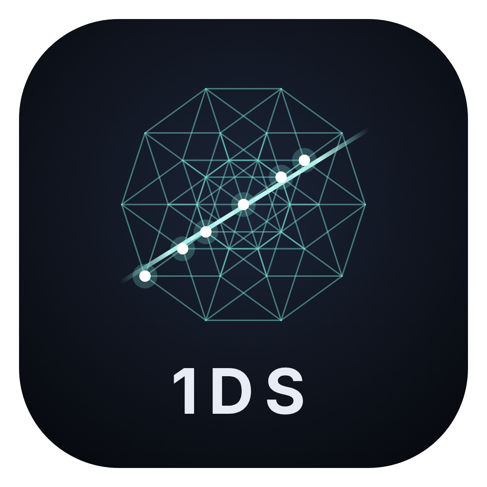

# Monad Slice

An instrument that plays slices of higher-dimensional shapes, tuned so nothing beats or grates. Smooth by design.

## Download

**[Get the latest version](../../releases/latest)**, then pick the Mac or Windows zip.

- **Mac:** unzip and move Monad Slice to Applications, then open it. macOS blocks it the first time because it isn't signed yet. Go to **System Settings › Privacy & Security**, scroll down and click **Open Anyway**.
- **Windows:** unzip and run `Monad Slice.exe`. If a blue SmartScreen box appears, click **More info**, then **Run anyway**.

## Playing

- Click the strip, or play the computer keys `A` to `'` and `Q` to `]`. `Z` and `X` move up and down.
- Plug in a MIDI keyboard and open **MIDI** to see which key plays which note, and to map your knobs.
- The arrows by the name at the top switch between forms. On the Quasicrystal and the Euler lattice, the round sticks (or a gamepad) slide the slice through the shape.
- **Preferences** has three themes: Serene, Nostalgia Bait and DaVinci.

This repo holds the downloads only.
